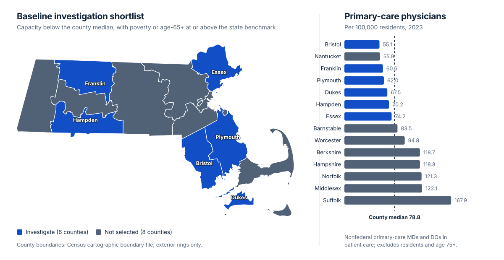

# Massachusetts Primary Care Access Planning

The baseline screen shortlists six of Massachusetts' 14 counties for a closer look at primary-care access: Bristol, Dukes, Essex, Franklin, Hampden and Plymouth.

Change the cutoffs and the list changes. Eight parameter settings produced five different shortlists, and Franklin and Hampden made all of them. Bristol, Dukes and Plymouth held under all four physician-supply settings. Essex drops out under a stricter supply cutoff, and Barnstable enters under a broader one. Four of the eight settings reproduce the baseline exactly, so how often a county is selected is not a probability.

Counties make the baseline list when they fall below the county median of 78.8 primary-care physicians per 100,000 residents and have poverty at or above 9.98% or an age 65+ share at or above 17.47%. Both context cutoffs are population-weighted Massachusetts figures. Physician supply, poverty and age stay separate instead of being combined into one score.



*Left: the six baseline shortlist counties. Right: primary-care physicians per 100,000 residents against the county median of 78.8. Built from `dashboard/Data/dashboard.csv`, the same data behind the Tableau workbook.*

The [two-page decision memo](docs/decision_memo.pdf) covers the finding, the recommendation, the uncertainty and what is still missing. The Tableau workbook is [`dashboard/MA_Primary_Care_Access.twbx`](dashboard/MA_Primary_Care_Access.twbx). It includes its extract, so it opens in Tableau Desktop or Tableau Public without an account.

## Run it

Requires Python 3.11+.

```sh
python3 -m venv .venv
.venv/bin/python -m pip install -r requirements-lock.txt
.venv/bin/python -m pip install --no-deps .
.venv/bin/python -m pytest -q
.venv/bin/ma-access run
.venv/bin/ma-access memo
.venv/bin/ma-access dashboard
```

The Massachusetts extracts are committed, so this runs offline. To rebuild them from the original federal sources, run `.venv/bin/ma-access fetch`.

Every setting's outcome is in [`analysis/findings.json`](analysis/findings.json). [`analysis/county_comparison.csv`](analysis/county_comparison.csv) keeps all 14 counties, including those never selected.

## Limitations

The shortlist is a screen for follow-up research. It does not measure unmet need or appointment availability.

Physician headcounts are not full-time equivalents, open panels, insurance acceptance or travel time, and they exclude nurse practitioners and physician assistants. ACS values describe a five-year period, not the current year.

County averages hide neighborhood barriers and care across county lines, and resident counts miss seasonal population. Nantucket has low physician supply but misses the baseline context rule. That reflects the screening design, not good access. High-supply counties such as Suffolk can still have real barriers. More in [limitations](docs/LIMITATIONS.md).

## Reference

| Source | Publisher | Coverage | Used for |
|---|---|---|---|
| AHRF 2024–2025 county file | HRSA | 2023 counts, 2022 for a prior-year check | Non-federal primary-care physician headcounts (MDs and DOs in patient care; excludes hospital residents and physicians aged 75+; **excludes NPs and PAs**) |
| ACS 2019–2023 five-year estimates | US Census Bureau | 2019–2023 | Population and age (B01001), poverty (B17001), and margins of error. Five-year coverage includes the small island counties |
| Cartographic boundary file, 1:500,000 | US Census Bureau | 2023 | County geometry for the map |

Download URLs and retrieval dates are in [`data/source_register.json`](data/source_register.json). The [source notes](docs/SOURCES.md) explain field selection and time alignment.

All 14 counties are joined on five-digit FIPS codes, and the build stops if a county is missing, duplicated or unrecognized. Poverty uses the population with poverty status determined as its denominator, not total population. Python handles download, validation and margins of error. SQL joins the sources and calculates the county measures. Suppressed or unavailable values stay missing, not zero, and the margin-of-error settings are sensitivity ranges, not significance tests.

[Metric definitions](docs/METRICS.md) · [Data dictionary](docs/DATA_DICTIONARY.md) · [Validation](docs/VERIFICATION.md) · [Dashboard notes](dashboard/README.md)
